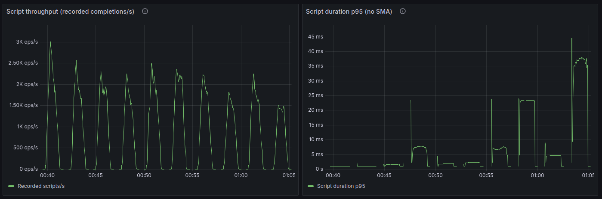
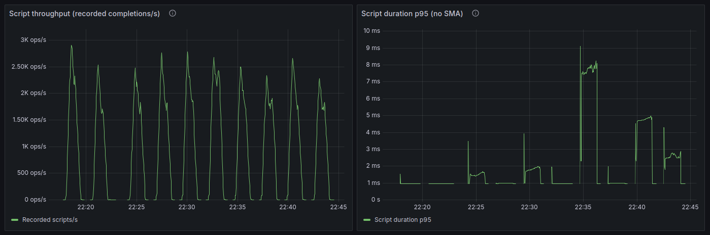

# ceph-tbb experiments

Benchmarks comparing the RGW Lua `RGW` table on `main` with two candidate implementations, both with a stateless `pairs()`:
- an unsharded `tbb::concurrent_hash_map`;
- a sharded `std::map` with TBB locks.

| | tree | RGW table |
|---|---|---|
| **baseline** | `~/code/ceph` (`main` + a Prometheus metrics commit) | `std::unordered_map` + one global `std::mutex`; `pairs()` iterates without a lock |
| **candidate: `concurrent_hash_map`** | `~/code/ceph-tbb` (`wip-lua-tbb-chm`) | one unsharded `tbb::concurrent_hash_map` behind one Ceph `RWLock` (shared for reads and writes, exclusive for iteration); TBB accessors lock each element; stateless `pairs()` that scans the whole map for the smallest key after the previous one |
| **candidate: sharded `std::map`** | `~/code/ceph-lua-sharded-map` (`wip-lua-sharded-map`) | 256 shards, each a plain `std::map` (not a TBB container) guarded by a `tbb::spin_rw_mutex`, plus a `tbb::spin_mutex` on each entry; stateless `pairs()`. TBB is used only for the locks |

## Run of 2026-11-18, 00:40–01:05: `tbb::concurrent_hash_map` candidate



Same dashboard and setup as the run below. There are 10 warp runs, alternating baseline and the `concurrent_hash_map` candidate for each script. Note the right panel's scale goes up to 45 ms here, against 10 ms below.

| time | script | tree | Lua p95 | warp total obj/s |
|---|---|---|---|---|
| 00:39–00:41 | [bucket_stats](scripts/bucket_stats.lua) | baseline | ≤1 ms | 2,353 |
| 00:42–00:43 | [bucket_stats](scripts/bucket_stats.lua) | candidate | ≤1 ms | 2,066 (−12%) |
| 00:45–00:46 | [hot_increment](scripts/hot_increment.lua) | baseline | ~1.5 ms | 2,088 |
| 00:47–00:49 | [hot_increment](scripts/hot_increment.lua) | candidate | ~7–7.7 ms | 1,872 (−10%) |
| 00:50–00:51 | [large_values](scripts/large_values.lua) | baseline | ~1.8–2.0 ms | 2,171 |
| 00:52–00:54 | [large_values](scripts/large_values.lua) | candidate | ~2.2 ms | 2,263 (+4%) |
| 00:55–00:57 | [per_request_keys](scripts/per_request_keys.lua) | baseline | ~7–7.5 ms | 1,992 |
| 00:58–00:59 | [per_request_keys](scripts/per_request_keys.lua) | candidate | ~23.5 ms | 1,597 (−20%) |
| 01:00–01:02 | [read_mostly](scripts/read_mostly.lua) | baseline | ~4.5–4.7 ms | 1,935 |
| 01:03–01:05 | [read_mostly](scripts/read_mostly.lua) | candidate | ~35–38 ms | 1,457 (−25%) |

The p95 values are read by eye from the dashboard. The obj/s totals come from warp's report (results folder `20261118-003843`). No warp errors and no radosgw crashes in either tree.

**Takeaways:**
- **The `concurrent_hash_map` candidate was slower than `main` here**, the opposite of the sharded `std::map` run below:
  - Lua p95 was about 5× higher for `hot_increment`, 3× for `per_request_keys` and 8× for `read_mostly`;
  - this time the slowdown was large enough to lower warp's throughput too, by 10–25%.
- **The stateless iterator isn't the cause.** None of these 5 scripts call `pairs()`.
- **The likely cause is lockdep, which this setup turns on:**
  - `vstart` writes `lockdep = true` into `ceph.conf`;
  - this candidate's table lock is a Ceph `RWLock` built with lockdep checking (`RWLock{"rgw_lua_background_table", false, true, true}`), so every table access also goes through lockdep's single global registry;
  - `main` uses a plain `std::mutex`, and the `std::map` candidate uses TBB locks, so neither goes through lockdep;
  - this run therefore penalises this candidate in a way a production build wouldn't.
- **To measure the container itself,** rerun with lockdep off (`vstart.sh --nolockdep`), or construct the `RWLock` without lockdep.

## Run of 2026-11-17, 22:17–22:45: sharded `std::map` candidate

In this run the candidate's table was a set of sharded `std::map`s, not a TBB container. TBB supplied only the locks (`tbb::spin_rw_mutex` per shard, `tbb::spin_mutex` per entry). The last committed version of the branch uses `tbb::concurrent_hash_map` instead; it wasn't benchmarked here.



The dashboard shows radosgw's own Lua metrics over the whole run.

- **Left: script completions per second.** There's one peak per warp run: 10 runs, alternating baseline and candidate for each script.
- **Right: p95 of `rgw_lua_duration_seconds`.** That's the time spent running the prerequest script for each request, timed around `rgw::lua::request::execute`. The histogram's smallest bucket is 1 ms, so anything faster shows as about 1 ms.

Runs, in order:

| time | script | tree | Lua p95 |
|---|---|---|---|
| 22:18–22:19 | [bucket_stats](scripts/bucket_stats.lua) | baseline | ≤1 ms |
| 22:20–22:22 | [bucket_stats](scripts/bucket_stats.lua) | candidate | ≤1 ms |
| 22:24–22:26 | [hot_increment](scripts/hot_increment.lua) | baseline | ~1.5–1.7 ms |
| 22:27–22:28 | [hot_increment](scripts/hot_increment.lua) | candidate | ≤1 ms |
| 22:29–22:31 | [large_values](scripts/large_values.lua) | baseline | ~1.8–2.0 ms |
| 22:32–22:34 | [large_values](scripts/large_values.lua) | candidate | ≤1 ms |
| 22:35–22:36 | [per_request_keys](scripts/per_request_keys.lua) | baseline | ~7.5–8.2 ms |
| 22:37–22:39 | [per_request_keys](scripts/per_request_keys.lua) | candidate | ≤1 ms |
| 22:40–22:41 | [read_mostly](scripts/read_mostly.lua) | baseline | ~4.6–5.0 ms |
| 22:42–22:44 | [read_mostly](scripts/read_mostly.lua) | candidate | ~2.5–2.9 ms |

**Takeaways:**
- **The candidate's Lua script time is lower in every pair where it can be measured:** at least 7× for `per_request_keys`, about 1.8× for `read_mostly`, and from 1.5–2 ms down to under 1 ms for `hot_increment` and `large_values`.
- **The S3 request rate (left panel) is about the same for both trees.** It's capped at about 2–2.9K/s by the cluster: Debug builds, a single OSD, and `debug_rgw=20` logging. The script's few milliseconds don't change it.
- **Run setup:**
  - only the scripts that never call `pairs(RGW)` (`SET=safe`);
  - 100 concurrent clients, 60 s each;
  - a fresh `vstart` cluster for every run.

  On `main`, a script that iterates while other requests write can crash radosgw: an earlier run segfaulted on [`iter_invariant.lua`](scripts/iter_invariant.lua).

Full details are in [results.md](results.md): run order and timestamps, warp throughput and latency for each run, the crash backtrace, and caveats.

## How the runs were made

- **Scripts and runner:** copies are in [scripts/](scripts/). The originals live in `~/code/ceph-tbb/lua-bench/`.
- **Command:**

  ```bash
  SET=safe lua-bench/run_all.sh
  ```
- **Per script:** the runner, [run_all.sh](scripts/run_all.sh), starts a fresh cluster in each tree, installs the script as the `prerequest` script, runs `warp mixed`, and stops the cluster, alternating baseline and candidate.
- **Each script isolates one access pattern.** The 5 scripts in the dashboard run:

  | script | what it does |
  |---|---|
  | [bucket_stats.lua](scripts/bucket_stats.lua) | per-bucket counters |
  | [hot_increment.lua](scripts/hot_increment.lua) | `RGW.increment` on 4 shared keys |
  | [large_values.lua](scripts/large_values.lua) | 900-byte values |
  | [per_request_keys.lua](scripts/per_request_keys.lua) | each request uses only its own keys |
  | [read_mostly.lua](scripts/read_mostly.lua) | 500 reads of 50 shared keys |

- **Not in the dashboard run.** These scripts call `pairs(RGW)`, which races on `main` (`SET=racy` selects them):

  | script | what it does |
  |---|---|
  | [iter_invariant.lua](scripts/iter_invariant.lua) | checks that each walk sees 1,000 unchanging keys exactly once while other requests write; crashed `main`'s radosgw |
  | [prune_ttl.lua](scripts/prune_ttl.lua) | a cleanup job that erases expired keys while walking the table |
  | [scan_readonly.lua](scripts/scan_readonly.lua) | a full walk over 5,000 keys |
  | [scan_with_writers.lua](scripts/scan_with_writers.lua) | 1 request in 10 walks the table while the others insert and erase |
